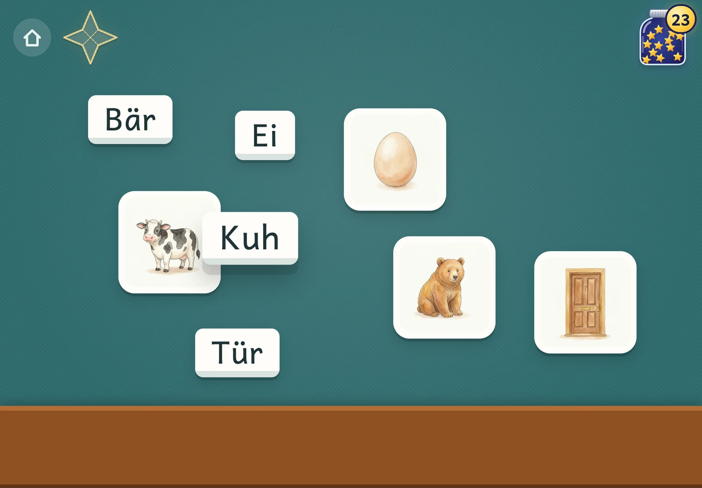
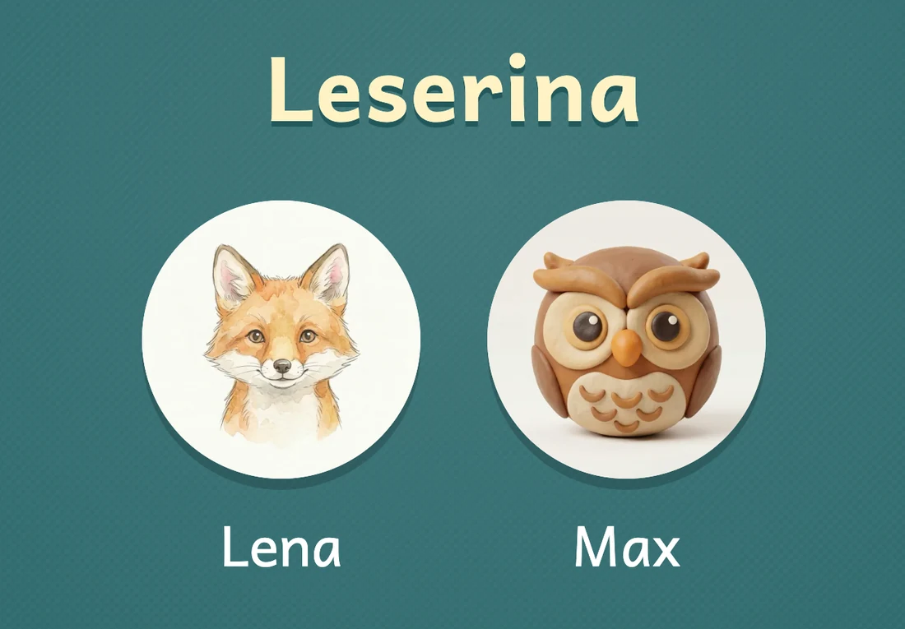
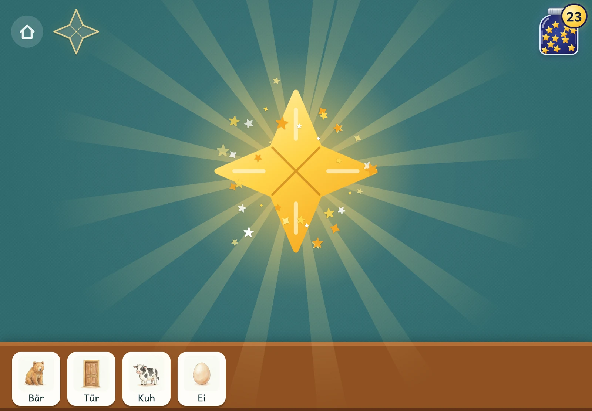
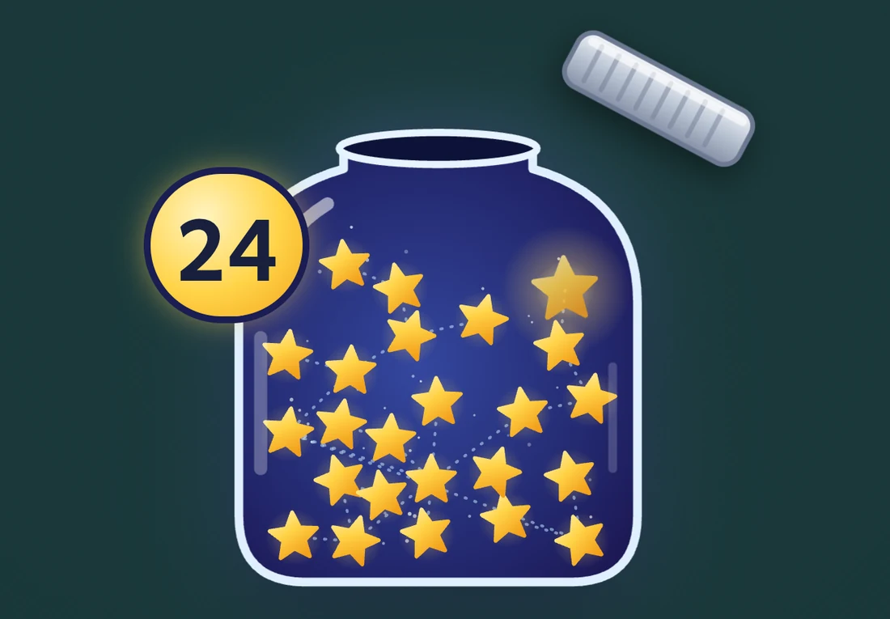
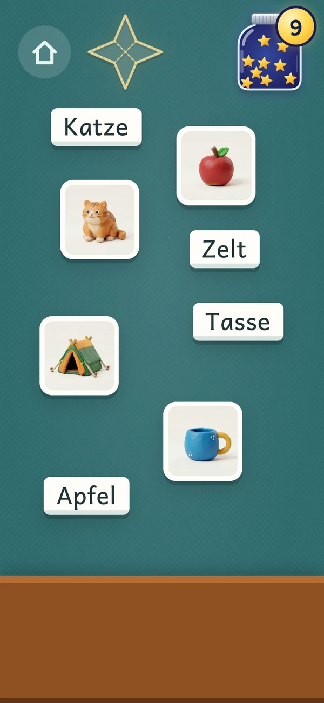

# Leserina

<p align="center">
  
</p>

A reading game for young children, made by a parent for their own kids and published as is.
It runs in the browser and installs as a full-screen app on a tablet or phone:
**https://sadilek.github.io/leserina/**. The words and the interface are German.

Pictures and words lie scattered on a mat; the child drags a word onto its picture (or the picture
onto its word). Each pair fills an arm of a gold star, and a full star goes into the child's
jar of night sky, where the stars collected so far form a constellation. Tapping a picture or a word reads the word aloud, in a parent's own voice; a pair just made is sounded out first, letter by letter ("Mmm–au–sss … Maus"). Words
start easy and get harder per child, and the ones a child gets wrong come back, as with flashcards.
For children who know their letters, every second round can be one of laying words instead: a
picture, an empty field per sound, and the word's letters on tiles to drag into place.

<table>
  <tr>
    <td width="33%"></td>
    <td width="33%"></td>
    <td width="33%"></td>
  </tr>
  <tr>
    <td align="center">Each child picks their own animal.</td>
    <td align="center">Four pairs make a full star.</td>
    <td align="center">The stars collect in the jar.</td>
  </tr>
</table>

<p align="center">
  <br>
  <em>On a phone, with the other picture style, round 3D clay.</em>
</p>

Everything runs on the device: no account, no tracking. Progress lives in the browser's local
storage. Optionally, a family's devices (say an iPad and a phone) share it through a small server,
so a child can carry on from any of them; see "Syncing between devices".

## Running it

```bash
npm install
npm run dev        # http://localhost:5180/leserina/, also on the LAN address Vite prints
npm run check      # type check and unit tests
npm run build      # static site in dist/, with a service worker for offline use
npm run preview    # serves dist/ on http://localhost:5181/leserina/
```

While `npm run dev` runs, the app syncs with a local worker at port 8787 of the same host, so
testing never touches the families' real data: `cd worker && npm install && npm run dev`.
Two origins make two devices on one machine, e.g. `http://localhost:5180/leserina/` and the LAN
address Vite prints. `VITE_SYNC_URL` overrides the worker's address.

## Publishing and updating

A push to `main` publishes the app: the GitHub Actions workflow (`.github/workflows/pages.yml`)
runs `npm ci`, `npm run check` and `npm run build` and deploys `dist/` to GitHub Pages. Installed
apps update themselves (`registerType: 'autoUpdate'`): they look for a new version when they
start, whenever they come back to the foreground and every hour while open, fetch it in the
background and switch to it on the start screen (never during a round). A home-screen app mostly
resumes from the background rather than starting anew, which is why the foreground check matters.
The parents' corner shows at the bottom when the running version was built.

The address must never change. An installed app keeps its data (profiles, stars, learning state)
in `localStorage`, which belongs to its origin, `https://sadilek.github.io`, and the app is
installed for the path `/leserina/`. Under a new address it would start empty. Hence:

- The repository stays `sadilek/leserina`, and Vite's `base` stays `/leserina/`.
- `sadilek.github.io` must never get a custom domain. GitHub would then redirect every project
  page of the account to that domain, the origin would change, and every installed app would
  lose its data.

## Installing

- iPad (Safari): open https://sadilek.github.io/leserina/, then "Teilen → Zum Home-Bildschirm".
- Android (Chrome): open the address, then the menu (⋮) → "App installieren".

Chrome on Android installs the app as part of Chrome: the app and a Chrome tab at the address
share their data. Clearing Chrome's data or browsing history for `sadilek.github.io` therefore
also wipes the app's progress. On a device connected to the family (see below), entering the
family code again brings everything back.

The installed app starts full-screen and works offline: every picture and clip is cached on
install. On the iPad this also protects the data: iOS may wipe a website's storage after 7 days
without use, but not that of a home-screen app. The game works in both orientations, on a phone
too; on Android the back gesture during a round only returns to the start screen.

## Syncing between devices

In the parents' corner, "Geräte verbinden" connects a family's devices. The first device creates
a family code: five words from a German word list (`src/family-words.txt`, 2048 words, CC0, from
[wordlists-de](https://codeberg.org/fossarchive/wordlists-de)), about 55 bits, so nobody guesses
it. Every other device has the code typed in; the first four letters of each word are enough.
The code is the only key to the family's data, so there is no link: on the iPad a link would open
Safari anyway, whose storage is separate from the home-screen app. "Trennen" stops syncing on a
device and keeps what it shows.

What is stored online, under the family code and nothing else: the children's names and animals,
their settings, their learning state and star counts, per device. No accounts, no other data.

How it works (`src/merge.ts`, with tests that play on two devices offline and then sync):

- localStorage stays the working copy; the app works fully offline. Each device keeps its own
  document (what happened on it) and the other devices' documents as last fetched; merging them
  gives what the app shows. Data from before syncing became the device's own document.
- A sync fetches all documents of the family, merges and uploads the device's own: at app start,
  when the app comes back to the foreground, when the device goes online and after each finished
  round. Requests time out after 6 seconds; failures stay silent, and the parents' corner shows
  when the device last synced.
- Each device only ever writes its own document, so nothing conflicts. Name, animal and settings:
  the latest change wins. Stars and rounds: each device counts its own, the total is the sum.
  Word states: the latest wins per word; a word may come up a round early after devices played
  apart, but none is lost. A reset starts a new count on every device; a deleted profile stays
  deleted. The unfinished round stays on its device. One without a pair made yet is dealt anew
  when it next opens if the words due have changed since, for example after rounds on another
  device (wrong drops and words heard in it are dropped too); a round on screen never changes.
- Two devices that each had a profile for the same child before connecting show both; the
  parents' corner points this out, and the unwanted one is deleted there.

The server is a Cloudflare Worker in `worker/` with one Durable Object per family, stored in the
EU, one row per device. It checks the code's format, the device id, that the body is a JSON
object below 256 KB, and that a family has at most 10 devices (a wiped device comes back under a
new id; its old document keeps counting). It answers only the published app and local dev
servers (CORS). It runs at https://leserina-sync.sadilek.workers.dev, set in `src/sync.ts`. Cloudflare's free plan allows 100,000 requests
a day and 5 GB; past a limit, requests fail until the daily reset, nothing is billed, and the
app syncs later.

Setting it up (once): create a free Cloudflare account, choose its `workers.dev` subdomain in
the dashboard (Workers & Pages), then:

```bash
cd worker
npm install
npx wrangler login     # opens the browser, once per Mac
npm run check          # type check and tests, in the Workers runtime
npx wrangler deploy    # prints https://leserina-sync.<subdomain>.workers.dev
```

Changes to the worker are deployed the same way, by hand. A new address goes into `src/sync.ts`;
installed apps pick it up with the next update.

## The voice

The clips in `audio/` are the owner's own voice, rendered through a voice clone at ElevenLabs. They are not
under the MIT license of the code: you may use them only with this app. To use another voice,
render your own clips (see below) or delete them; without a clip, the device's own German voice
reads the word.

## How it is built

- `words.json`: the word list, sorted from easy to hard, with a difficulty score and level 1-5
  per word. Generated by `npm run words` (`scripts/score_words.py`) from `data/words-source.csv`;
  the script's docstring explains the score. To move a word, put a number in that row's optional
  `adjust` column (negative = earlier) and rerun. Each word also lists its graphemes and their
  sounds (`sounds`), for sounding it out; see "Sounding out".
- `audio/<id>.mp3`: one clip per word, rendered by `npm run render-audio`
  (`scripts/render_audio.py`). By default the owner's ElevenLabs voice speaks them
  (`scripts/tts_elevenlabs.py`, with the key in `ELEVENLABS_API_KEY` or in the file named in
  `ELEVENLABS_KEY_FILE`); any other command that reads text on stdin and writes a WAV to
  `$DEMO_WAV` can, set in `LESERINA_TTS_CMD`. `--only`
  re-renders single words, `--names Lena,Max` renders the children's names for the start screen
  as `audio/name-<id>.mp3`. Those stay on the local machine (`.gitignore`), so children's names
  never reach the public repository; a name that is also a word (Mama, Papa) uses the word's
  clip, and the published app reads other names with the device's voice. The owner's own children, Katharina and Alexander, are the exception: their clips are
  in the repository (an exception each in `.gitignore`) and ship with the app.
  `scripts/check_audio.py` transcribes every clip with Whisper (it needs a Python environment
  with Whisper, such as the voice clone's) and lists those that may not say their word. Whisper
  itself cannot tell very short words (Ei, Ohr, Wal) apart, so a person has to listen to those.
  Without a clip, the device's own German voice reads the word.
- `pictures/<style>/<id>.webp`: one picture per word and per avatar, in two styles, soft
  watercolour (the default) and round 3D clay; each child's profile picks one in the parents'
  corner. Rendered by Nano Banana 2.1 through the Gemini API with `scripts/render_pictures.py`
  (about $0.04 a picture, so about $11 for all of them), from `data/picture-prompts.csv`. Without
  a picture, the word's emoji stands in. See `pictures/README.md`.
- `src/scheduler.ts`: the learning logic, a Leitner box system counted in rounds, as pure
  functions with tests that simulate children (`src/scheduler.test.ts`).
- `src/game.ts`: the game screen; `src/lay.ts`: the mat of a lay round (see "Laying words");
  `src/layout.ts`: scattering the cards on the mat;
  `src/start.ts`: picking a child; `src/parents.ts`: the parents' corner (hold the lock at the
  bottom right of the start screen).
- `src/star.ts`: the round's star (one arm per pair) and the jar. Each star in the jar has a fixed
  place (`jarSpots`), so a new star never moves the old ones; the jar shows up to 50, its badge
  counts them all.
- `src/store.ts`: profiles, stars, learning state and the unfinished rounds in `localStorage`;
  `src/merge.ts`, `src/sync.ts`, `src/familycode.ts` and `worker/`: syncing between devices.
- `docs/screenshots/`: the pictures in this README, taken from `npm run dev` in a headless
  Chrome (iPad landscape 1180×820 and phone 393×852) with two made-up children, Lena and Max.
- `mockups/`: static design drafts for themes (space, under the sea, dinosaurs, flower garden,
  building site), not part of the app and not in the published site. With `npm run dev`
  running, open http://localhost:5180/leserina/mockups/.

## Sounding out

After a match, and when a pair on the shelf is tapped, the game sounds the word out: it plays the
word stretched, sound by sound, as in first grade ("gedehntes Sprechen": "Mmm–au–sss"), with each
grapheme lighting up on the card as its sound starts, then the whole word. Sounds that can be held
are held (m, s, a), stops stay short (b, t, k) and have no "e" after them, and a word is spoken as
it sounds, not as it is written: Hund ends in a t. "Laute vorsprechen" in the parents' corner
switches it off per child; then a pair just says its word, as before. "Alle Wörter anhören" there
sounds out every word, to listen through the clips.

Linking letters to sounds is what makes reading last (`docs/literature-review-early-reading.md`,
section 4): matching alone teaches word shapes.

- The graphemes and sounds: `scripts/phonics.py` splits each word into graphemes (a letter, or
  several for one sound: sch, au, ck, ie, a doubled consonant, a vowel with its lengthening h) and
  gives each the sound it stands for, by rules for regular German spelling. Where compounds and loan
  words break the rules (Mond, Bus, Giraffe, Flugzeug), the column `sounds` in
  `data/words-source.csv` spells them out by hand, e.g. `M|o=o:|n|d`. `npm run words` writes
  them into `words.json`.
- The clips: `scripts/render_stretched.py` has ElevenLabs read each word in the owner's voice,
  one piece per grapheme joined with dashes ("Mmm-auuu-sss"), into `audio/stretched/<id>.mp3`.
  Within a word the voice says plain sounds, which it does not for single letters (alone, b and t
  come out as "Be" and "Te"). When each grapheme starts goes into `src/stretched.json`: near
  ElevenLabs' own timestamp, which often lags by 0.1-0.25 s, where the spectrum changes most.
  The game lights each grapheme 80 ms before that: a letter lit as its sound starts looks late.
  A word whose graphemes change needs its clip rendered again; the tests fail until it is, and
  the game says such a word without sounding it out. Then `uv run scripts/cut_tiles.py` finds the
  tiles' sounds in the new clip (see "Laying words").
- Checking them: `uv run scripts/check_stretched.py` ranks the clips by how far a phoneme
  recogniser hears them from the sounds they should have, and flags clips that run too long (a
  voice that read "www" as an abbreviation once spelled it out, dashes included). It only hints
  where to listen first; an ear decides.

## Laying words

"Wörter legen" in the parents' corner (off by default, per child) makes every second round a lay
round, mostly for older children who know all their letters: building words from letters helps
reading new words most (`docs/literature-review-early-reading.md`, section 4; de Rose et al. 1996).
Which rounds are lay rounds goes by the number of rounds played, so a family's devices agree.

A lay round has as many words as "Pro Runde" says, picked by the same scheduler as any round
(see "The learning logic"), one at a time: the picture, below it an empty field per grapheme, and
below that a tile per grapheme, shuffled, with no extra letters. A grapheme is one tile, as it is
one lit-up unit when a word is sounded out: sch, au, ie, ck, ll, the ah of "Zahn", the er of
"Tiger". The child drags each tile onto its field; it plays its sound as it lands and settles in.
A tile dropped on a wrong field springs back. Tiles with the same letters fit either field (the
two a of "Mama"), a capital only the first. Tapping a tile plays its sound, tapping the picture
says the word; neither counts as help. A word laid without a wrong tile goes one box up; one
with a wrong tile goes back to box 1. Once laid, the word joins its picture as a pair, is sounded
out (or just said, with "Laute vorsprechen" off) and goes to the shelf, and the star gets an arm.
A round on screen keeps its kind when the setting changes, unless no word of it is done yet.

Where spelling and sound part, the tile shows the letter and plays the sound: the d of "Hund"
plays a t. That comes from where the tiles' sounds come from: each tile plays its own piece of
its word's stretched clip (see "Sounding out"), cut out at run time with short fades.

- Where each piece lies: `uv run scripts/cut_tiles.py` writes `src/tiles.json`. It starts from
  each grapheme's start in `src/stretched.json`, puts a cut in the pause the dash between two
  sounds often leaves, keeps the loudest run of each piece and keeps 30 ms off a seam where two
  sounds run into each other. A stop (b, d, g, p, t, k) starts at its burst and lasts 130 ms. The
  script's docstring has the details.
- Where a cut fails: a piece shorter than 0.1 s (not a stop), mostly because its start lies late,
  or one whose spectrum lies far from the other pieces of its sound, borrows the piece of another
  word with the same sound code. 19 of the 610 tiles do (several r and the final e of "Schere",
  "Spinne" and "Badewanne"); the script lists them. Single sounds rendered by ElevenLabs were the
  planned way out, but borrowing needs none of their workarounds (alone, b and t come out as
  "Be" and "Te") and keeps the voice of the clips.
- Checking them: "Alle Wörter anhören" in the parents' corner plays each word's tiles one by one
  in "Plättchen" mode. The cuts were checked against spectrograms, not by ear; the borrowed ones
  are the first to listen to. A clip rendered again needs `cut_tiles.py` again; the tests fail
  until it has run (`src/tiles.json` keeps a hash of each clip). Without a piece, the device's
  voice reads the tile's letters.

## Recording the sounds

The owner records each sound of the game once in their own voice, for later use in the game
(nothing plays them yet). `src/sound-list.json` lists the 44 sounds the words have, written by
`npm run words` (`sound_list` in `scripts/phonics.py`): first the sounds that can be held, then
the vowels, then the stops, each with an early word that has it, at its start where one does.

With `npm run dev` running, open http://localhost:5180/leserina/record.html (the page is not
part of the build, so it is never published). It shows one sound at a time, large, with its
example word, the grapheme for it marked, and how to say it: held sounds and vowels for about a
second, stops short and without an "e" after them ("b", not "be"). Hold the space bar (or the big
button), speak, let go: the take is played back and the next sound without a take comes up. The
arrow keys go back and forth, "Nochmal" goes back to the sound just recorded, "Anhören" plays a
sound's take, and the overview below marks the sounds recorded so far; holding the space bar on
a recorded sound records it again. The page keeps 0.3 s from before the key went down and after
it came up, and the dev server saves each take as `audio/sounds/raw/<file>.wav` (`vite.config.ts`),
with an ASCII name (`a:` as `a-lang`, `ä` as `ae`, `ə` as `schwa`, `ɐ` as `er`).

Then `uv run scripts/prepare_sounds.py` cuts the silence at both ends, levels each take to the
word clips in `audio/` and writes `audio/sounds/<file>.mp3`. It lists the sounds still missing and
those that are suspiciously short, long or quiet; those are the ones to listen to and record again.

## The learning logic

Every word a child has seen sits in a box 1-5 and has the round it is due next: box 1 next round,
then 2, 4, 8 and 16 rounds later. Box 5 counts as known.

- Dropped on a wrong partner at least once: back to box 1. The word that was dragged counts as wrong.
- Right on the first try without help: one box up.
- Right, but the child tapped the word first and heard it: stays in its box. Tapping a picture is
  no help.
- The last pair of a round is right by elimination: stays in its box.

A round takes the due words in boxes 1-3 first (most overdue first), then up to 2 new words in
difficulty order while at most 8 words sit in boxes 1-2, then due words in boxes 4-5, then
not-yet-due words from the lowest boxes. Reviews of nearly known words wait behind the new ones
so that a child who gets everything right keeps getting new words. Words below the child's start
level are never introduced.

Once a child has 10 words in box 3 or higher, a round tries to have two words with the same first
letter (Maus and Mama), so that the child cannot find a card by its first letter alone and has to
read on. To get such a pair, a not-yet-due word gives way to another known word, a due word to one
due in the same round from the same box, or a new word to a later new word of the same level. Due
words are never pushed out, and new words still come level by level. Without this, about a third
of rounds have such a pair by chance; with it, about two thirds.

What research says about games like this one (from what age they help, and whether they can get in
the way of learning to read and spell later): `docs/literature-review-early-reading.md`.

## License

The code is under the MIT license (`LICENSE`). The voice clips in `audio/` are not; see
"The voice" above.
